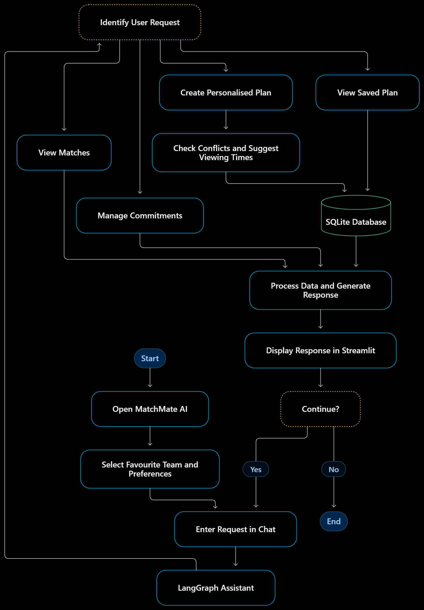

# 🏏 MatchMate AI — Personalised Cricket Viewing Planner

**A conversational planner that helps cricket fans fit matches around college, work and family commitments.**

[](https://www.python.org/)
[](https://streamlit.io/)
[](https://www.langchain.com/langgraph)
[](https://groq.com/)
[](https://www.sqlite.org/)

> **Prototype status:** All match fixtures are **synthetic test data**. MatchMate does not connect to a live cricket-data provider and must not be used to find real match timings.

---

## 📌 Overview

MatchMate AI connects a fan's cricket interests with their daily schedule. Users chat in natural language to save preferences, add commitments, and generate a ranked viewing plan that shows which matches they can watch fully, partly, or only as highlights.

**Design principle:** the LLM only interprets what the user typed. Deterministic Python code does all date validation, time calculations, ranking and storage, so a model error cannot silently corrupt a schedule.

## ❗ Problem Statement

Cricket fans, especially students and working professionals, struggle to follow matches around classes, work, assignments and family time. Match timings and personal calendars live in different places, so users compare them by hand.

## ✨ Current Features

- **Conversational interface:** Streamlit chat with saved conversations, quick-prompt buttons and a editable display name.
- **Preference management:** favourite teams, players, tournaments, preferred formats (T20, ODI, Test, T10) and important match IDs.
- **Commitment management:** add, list and delete commitments with a title, type, start/end time, timezone and notes. Types: `work`, `meeting`, `class`, `study`, `family`, `travel`, `appointment`, `exercise`, `meal`, `sleep`, `chore`, `other`.
- **Personalised planning:** ranks fixtures in a date range by relevance and recommends a viewing option for each: `live`, `watch_full`, `watch_partial`, `catch_up` or `unavailable`.
- **Conflict handling:** detects overlaps between a match and your commitments, then computes the free windows left over.
- **Persistent storage:** profiles, commitments, conversations, messages and saved plans are stored in SQLite.
- **Offline fallback:** if no Groq key is set or the API call fails, a rule-based intent parser keeps the basic commands working.

## 🏗️ How It Works



## 🛠️ Technology Stack

| Technology | Purpose |
|---|---|
| **Python 3.11+** | Application logic, validation and scheduling engine |
| **Streamlit** | Chat interface and plan display |
| **LangGraph** | Workflow orchestration and conditional routing |
| **Groq (`langchain-groq`)** | Intent and field extraction from natural language |
| **SQLite** | Persistence for profiles, commitments, sessions and plans |
| **python-dotenv** | Loads local environment variables |
| **pytest** | Automated tests |

## 📁 Project Structure

```text
MatchMate/
├── app.py                                  # Streamlit UI
├── requirements.txt
├── README.md
├── src/assistant/
│   ├── personalisation_graph.py            # LangGraph workflow and intent extraction
│   ├── personalisation_engine.py           # Scoring, conflicts, viewing windows
│   ├── personalisation_response_formatter.py
│   ├── personalisation_flow.py             # Optional command-line flow
│   ├── planning_repository.py              # SQLite persistence layer
│   └── match_schedule_service.py           # Loads synthetic fixtures
├── data/personalised_planning/             # matches.json, playing_xi.json, team_squads.json
└── tests/
```

> **Note:** the fixture files must be present in `data/personalised_planning/` for plans and for 12 of the tests to work. If they are missing after you clone, see [Limitations](#-limitations).

## 🚀 Installation and Setup

### Prerequisites
- Python 3.11 or newer
- Git
- A Groq API key (optional; without it the app uses the rule-based fallback)

### 1. Clone the repository
```bash
git clone https://github.com/nirajg5/MatchMate.git
cd MatchMate
```

### 2. Create and activate a virtual environment
Windows PowerShell:
```powershell
python -m venv .venv
.venv\Scripts\Activate.ps1
```
macOS / Linux:
```bash
python -m venv .venv
source .venv/bin/activate
```

### 3. Install dependencies
```bash
python -m pip install --upgrade pip
pip install -r requirements.txt
```

### 4. Configure environment variables
Create a `.env` file in the project root:

```env
GROQ_API_KEY=your_groq_api_key
GROQ_MODEL=llama-3.3-70b-versatile
```

| Variable | Required | Default |
|---|---|---|
| `GROQ_API_KEY` | No | If unset, the rule-based parser is used |
| `GROQ_MODEL` | No | `llama-3.3-70b-versatile` |

The database path (`data/personalised_planning/planning.db`) and default timezone (`Asia/Kolkata`) are currently set in code, not through environment variables. **Never commit a real API key.**

### 5. Run the application
```bash
streamlit run app.py
```
Open the local URL shown in the terminal.

## 💬 Usage

**Set preferences**
```text
My favourite team is India.
Favourite players: Virat Kohli, Jasprit Bumrah
I prefer T20
```

**Add a commitment**
```text
Add commitment: college assignment submission on 2026-10-15 from 17:00 to 18:00, type study
```

**Generate a plan**
```text
Create my plan from 2026-10-14 to 2026-10-20
```

**Retrieve saved information**
```text
Show my commitments
Show my saved plan
```

**Remove a commitment**
```text
Delete commitment <commitment id>
```

Dates in ISO format (`YYYY-MM-DD`) work most reliably, especially without a Groq key. With a key, relative dates such as "this weekend" are interpreted by the LLM.

## 🎯 Match Relevance Scoring

Each fixture gets an explainable score out of 100:

| Signal | Points |
|---|---|
| Includes a favourite team | 40 |
| Includes a favourite player in the playing XI | 25 |
| Part of a favourite tournament | 15 |
| Matches a preferred format | 10 |
| Marked as important by the fan | 10 |

Fixtures are sorted by score, then start time. The top 10 are returned by default, each with the reasons it was recommended.

## 🧪 Data Handling and Reliability

| Data category | Status in this project |
|---|---|
| Simulated data | **Used for all fixtures.** Each record carries `is_simulated: true`, and the engine rejects any fixture without it |
| Provider data | Not implemented |
| Cached data | Not implemented |
| Unavailable data | Playing XI status is carried on each fixture; no ball-by-ball data exists |

### Conflict detection

Two intervals overlap when:

```python
start_a < end_b and start_b < end_a
```

For an upcoming or in-progress match, the engine only considers the time that remains, then:
- No overlap → `watch_full` (or `live` if already in progress).
- Overlap with a long enough free window → `watch_partial`. The window must be at least 45 minutes or 25% of the remaining match, whichever is larger.
- Otherwise → `unavailable`.
- Already finished → `catch_up`.

Commitments are validated before use: the end must be after the start, both times must be present, and the timezone must be valid. Overnight commitments are not supported in the command-line flow.

## 🧪 Testing

```bash
python -m pytest
```

The suite has 39 tests covering the repository, intent parsing, the planning engine and the LangGraph workflow. Twelve of them need the fixture files in `data/personalised_planning/`; they fail with `FileNotFoundError` if those files are absent.

## ⚠️ Limitations

- **Synthetic fixtures only.** Plans do not reflect real match schedules.
- **Fixtures may be missing from a fresh clone.** The `.gitignore` currently excludes the whole `data/` directory, so `matches.json`, `playing_xi.json` and `team_squads.json` must be added separately until they are moved to a tracked location.
- **No cricket Q&A.** The LLM is used for intent extraction only. It does not answer general cricket questions or supply scores.
- **Single-user design.** There is no authentication or access control.
- **Fixed timezone default.** `Asia/Kolkata` is hard-coded, though individual commitments can specify another timezone.
- **LLM output needs validation.** Extracted fields are checked, but ambiguous phrasing can still be misread; the fallback parser handles only common phrasings.
- **No reminders or calendar sync.**

